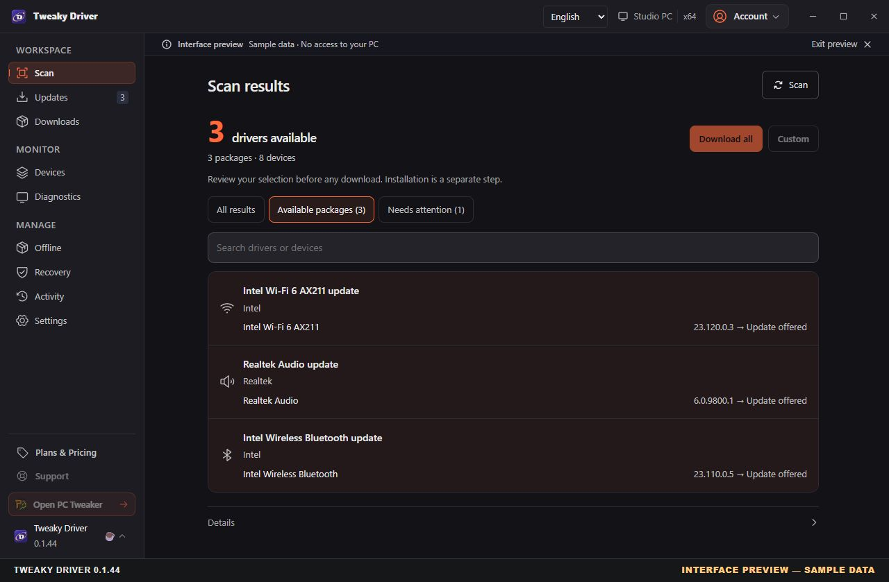
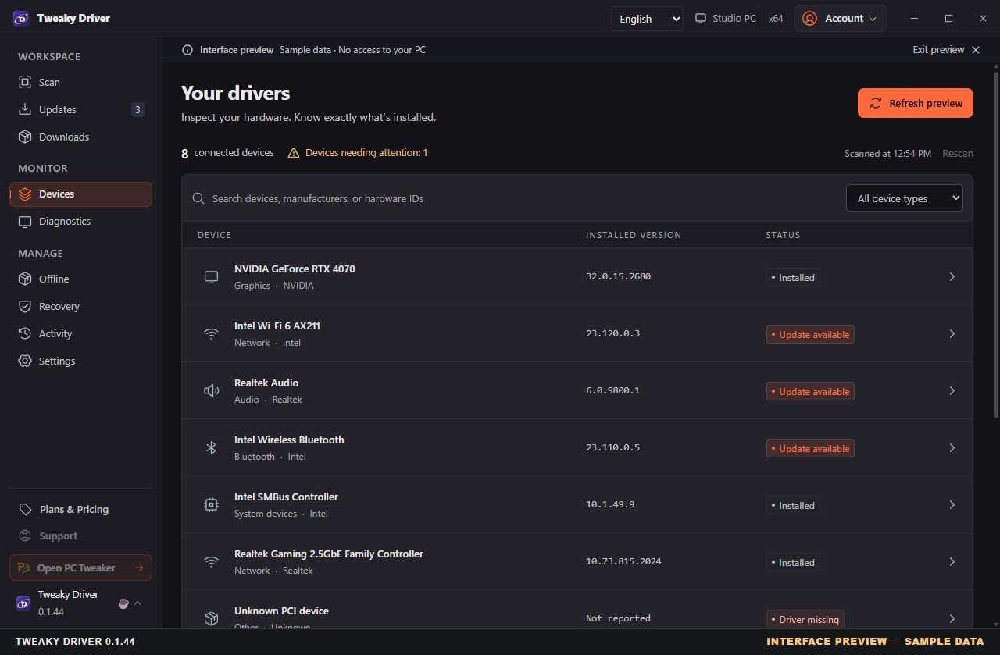
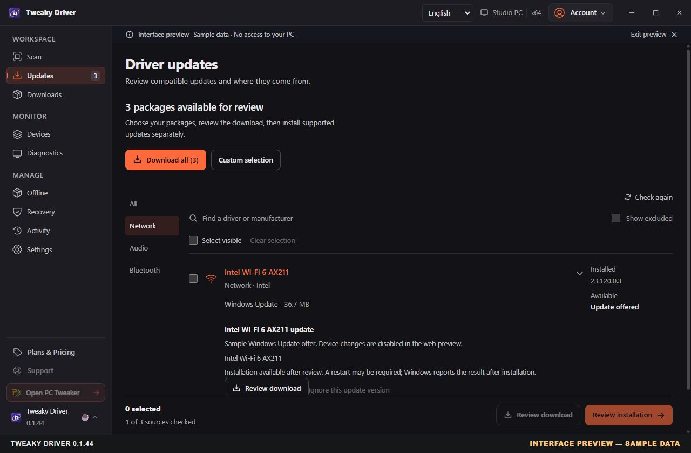

# Tweaky Driver — Windows Driver Inventory and Update Review

**Know your drivers before you change them.** Tweaky Driver brings your Windows 10/11 device inventory, installed versions and available update offers into one review workflow. Inspect the package source, choose what to download, and review installation separately.

[Product](https://pctweaker.app/tweaky-driver/) · [Official downloads](https://github.com/AurelioAvila/Tweaky-Driver-Releases/releases/latest) · [Verify the publisher signature](https://github.com/AurelioAvila/.github/blob/master/CODE_SIGNING.md)

[Explore the official website](https://pctweaker.app/tweaky-driver/) · [Read the workflow and FAQ](https://pctweaker.app/tweaky-driver/#questions)

[Download the latest signed installer](https://github.com/AurelioAvila/Tweaky-Driver-Releases/releases/latest)

[](https://github.com/AurelioAvila/Tweaky-Driver-Releases/releases/latest)
[](https://www.softpedia.com/get/System/System-Miscellaneous/Tweaky-Driver.shtml)
[](https://www.majorgeeks.com/files/details/tweaky_driver.html)

<p align="center"></p>

*Version 0.1.44 interface preview, captured November 3, 2026. Device names, versions and offers are sample data; no real device scan, download or installation was performed.* [Capture details and hashes](docs/SCREENSHOTS.md).

## See the workflow

### 1. Inspect what is installed

Search the device inventory and read installed driver versions before deciding whether a change is needed.



### 2. Review the source and the next step

Open an offer to inspect its source and available package information. Downloading and installing are separate decisions; some packages are download-only.



All three images show the current release frontend in its built-in browser preview. The preview has no access to your PC and does not establish real-device compatibility or performance. [Full-size images and provenance](docs/SCREENSHOTS.md).

## What to expect

- A driver inventory that distinguishes detected devices from available offers.
- Separate download-ready offers and catalog candidates, so a search result is not mistaken for a compatible installation.
- Installed versions, available package metadata, sources and download information, with responsive scan cancellation.
- Release notes describing supported workflows, validation status and known limitations.

Driver discovery depends on compatible packages and supported sources. Universal
driver coverage is not promised, and some packages are download-only. Review the
specific offer and release notes before installing or purchasing; detection alone
does not establish compatibility or guarantee a performance improvement.

## Free and Pro

**Free:** one complete scan of supported sources every 10 days. The drivers that scan finds remain available to download and install until the next free scan unlocks. Device inventory and read-only diagnostics are always available. A free account with a verified email is required.

**Optional Pro:** unlimited scans, downloads and supported installations, plus saved jobs and offline kits. Review the [current plans and renewal terms](https://pctweaker.app/tweaky-driver/) before subscribing. Neither plan promises universal driver coverage.

## Download and verify

1. Open the [latest release](https://github.com/AurelioAvila/Tweaky-Driver-Releases/releases/latest) and read its notes.
2. Download the Windows x64 setup executable from that release's assets.
3. Check the file's digital signature in Windows Properties. The publisher should be **Aurelio Avila**; investigate a missing or invalid signature before running it.
4. Compare the downloaded file's SHA-256 with the digest shown in its official GitHub release asset details. Do not assume every release includes a separate checksum file. A matching hash does not replace publisher-signature verification.

Windows SmartScreen may still display a prompt for a signed application. Code
signing identifies the publisher and protects integrity; it does not guarantee
compatibility or the absence of software defects.

## Install with WinGet

Tweaky Driver is available in the community WinGet catalogue as `AurelioAvila.TweakyDriver`. Version **0.1.43** was verified in the live catalogue on November 2, 2026. The [new-package submission](https://github.com/microsoft/winget-pkgs/pull/442842) has been merged and its publication pipeline succeeded.

```powershell
winget show --id AurelioAvila.TweakyDriver --exact --source winget
winget install --id AurelioAvila.TweakyDriver --exact --source winget
```

Review the package details and installer prompts before proceeding. The catalogue and [latest official GitHub release](https://github.com/AurelioAvila/Tweaky-Driver-Releases/releases/latest) may update at different times; check the version in each source. An older cached index may need a normal `winget source update`.

## Reviews

Tweaky Driver is also on Softpedia and MajorGeeks. Checked October 24, 2026; feedback stays at its original source:

- [Softpedia](https://www.softpedia.com/get/System/System-Miscellaneous/Tweaky-Driver.shtml): user rating **5.0/5**; editorial review **4.0/5**, tested by Softpedia staff.
- [MajorGeeks](https://www.majorgeeks.com/files/details/tweaky_driver.html): user rating **5/5**; listing and reader reviews.

Third-party listings apply their own licence labels and may describe an older release; this repository's [LICENSE](LICENSE) and [release notes](https://github.com/AurelioAvila/Tweaky-Driver-Releases/releases) are the authoritative sources.

## Support and security

For help, contact [tweakydriver@pctweaker.app](mailto:tweakydriver@pctweaker.app) with the app
version, Windows version and steps to reproduce the issue. Do not include passwords,
license tokens or other sensitive data. Follow [SECURITY.md](SECURITY.md) when reporting
a suspected vulnerability.

## License and distribution

This repository distributes signed Windows x64 installers, release materials and package scripts. The original application source code is private and is not included. This is not an open-source project. See [LICENSE](LICENSE) for the copyright notice; third-party components retain their own licenses.

Read the release notes for supported features, validation status and current limitations before installing or purchasing. Driver discovery depends on compatible packages and supported sources; universal driver coverage is not promised. Some packages are download-only.

Publisher: **Aurelio Avila**. Installers, application binaries and uninstallers are signed and timestamped. Windows SmartScreen may still display a prompt.
